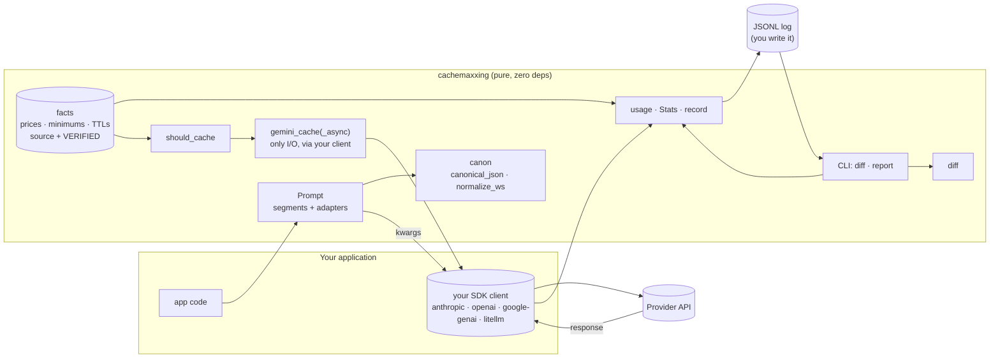
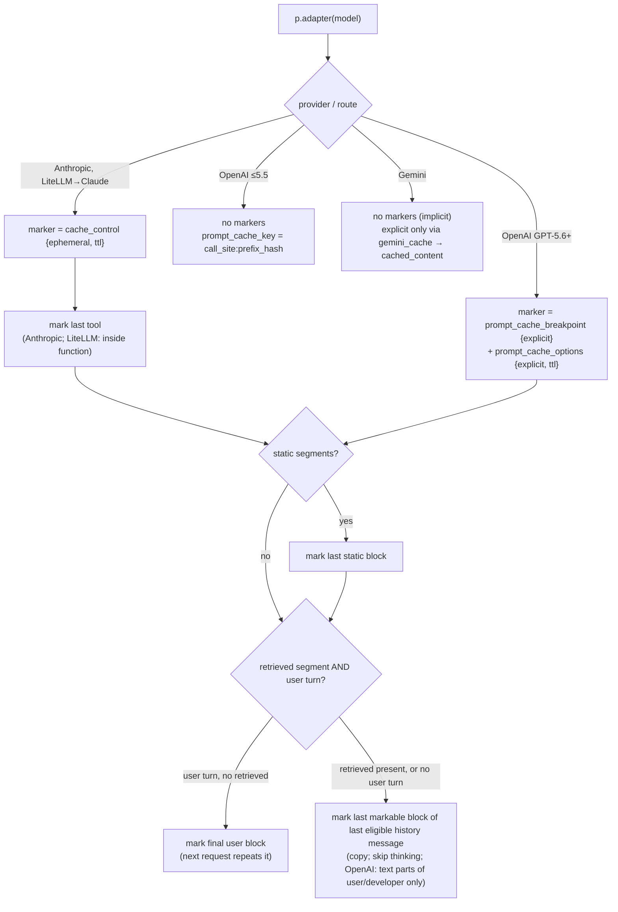
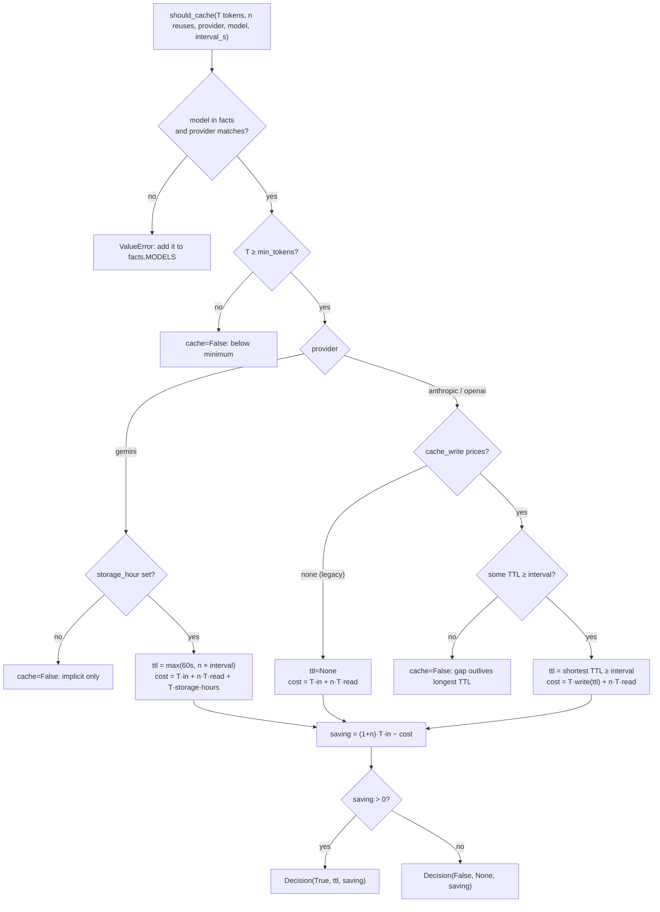
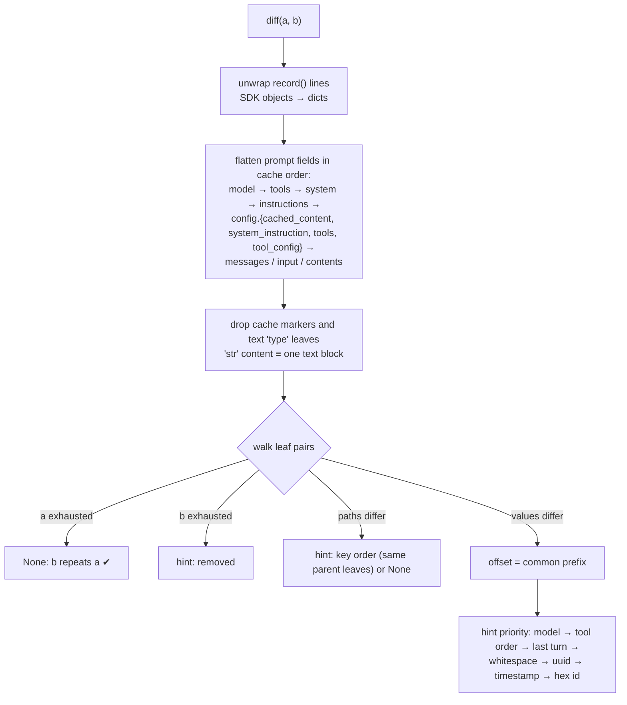
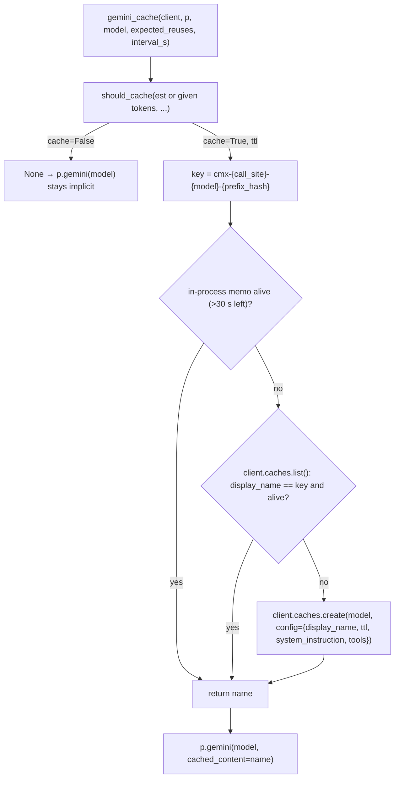
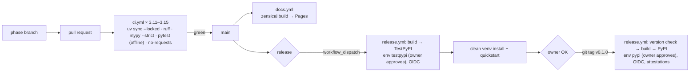

# cachemaxxing architecture

_Derived from the cachemaxxing v0.1 plan dated 2026-10-30._

## 5.1 Components



## 5.2 Request lifecycle

```mermaid
sequenceDiagram
  participant App
  participant P as Prompt
  participant SDK as Your SDK client
  participant API as Provider
  App->>P: tools / system / context / examples / history / retrieved / user
  App->>P: p.anthropic(model) | p.openai(model) | p.gemini(model) | p.litellm(model)
  P-->>App: kwargs (fixed order, canonical, cache markers)
  App->>SDK: create(**kwargs, max_tokens=...)
  SDK->>API: HTTPS
  API-->>SDK: response + usage
  SDK-->>App: response
  App->>App: u = usage(response); stats.add(call_site, u)
  App->>App: log.write(json.dumps(record(call_site, kwargs, response)) + "\n")
  Note over App: CI or ops: cachemaxxing report log.jsonl --min-hit-rate 0.6
```

## 5.3 Marker placement (FR-4, FR-5, FR-6, FR-8)



## 5.4 `should_cache` (FR-9)



## 5.5 `diff` (FR-12)



## 5.6 `gemini_cache` (FR-7)



## 5.7 CI/CD



## 5.8 Public API (v0.1)

```python
from cachemaxxing import Prompt, usage, diff, should_cache, Stats, record, gemini_cache

p = Prompt(call_site="support.answer")
p.tools(TOOLS).system(SYSTEM).context(DOCS).history(messages).retrieved(chunks).user(question)

resp = client.messages.create(max_tokens=1024, **p.anthropic("claude-haiku-5-5"))      # Anthropic
resp = client.responses.create(**p.openai("gpt-6-luna"))                                # OpenAI Responses
resp = client.chat.completions.create(**p.openai_chat("gpt-6-luna"))                    # OpenAI Chat
resp = client.models.generate_content(**p.gemini("gemini-3.8-flash"))                   # Gemini
resp = litellm.completion(max_tokens=1024, **p.litellm("anthropic/claude-haiku-5-5"))   # LiteLLM

u = usage(resp)        # u.input, u.cache_read, u.cache_write, u.output, u.est_cost, u.hit_rate
log.write(json.dumps(record("support.answer", kwargs, resp)) + "\n")
# $ cachemaxxing report log.jsonl --min-hit-rate 0.6     $ cachemaxxing diff a.json b.json
```

This refines the handoff's sketch in one way: **adapters take `model` and include it in the kwargs**. GPT-5.6+ breakpoint support, LiteLLM routing and pricing all depend on the model.

## 5.9 File structure

```
cachemaxxing/
├── .github/
│   ├── dependabot.yml
│   └── workflows/ {ci.yml, docs.yml, release.yml}
├── benchmarks/
│   ├── data/ {policy.md, docs.md, tools.json, questions.json}
│   ├── workload.py          shared workload, naive builders, Budget, summarize/write
│   ├── bench_gemini.py      bench_openai.py      bench_anthropic.py
│   ├── chart.py             results/*.json → docs/assets/benchmark.svg
│   └── results/ {gemini,openai,anthropic}.json
├── design/ {requirements.md, architecture.md, sdlc.md}
├── docs/
│   ├── index.md  quickstart.md  caching.md  diagnosing.md  reference.md  compare.md  changelog.md
│   ├── _facts.md             generated by `python -m cachemaxxing.facts`
│   └── assets/benchmark.svg
├── examples/quickstart.py    runnable; included in docs/quickstart.md
├── src/cachemaxxing/
│   ├── __init__.py  py.typed
│   ├── canon.py      canonical_json, normalize_ws, plain, jsonable, tool_name
│   ├── facts.py      PROVIDERS, MODELS, find, provider_of, markdown
│   ├── prompt.py     Prompt + anthropic/openai/openai_chat/gemini/litellm
│   ├── economics.py  Decision, should_cache
│   ├── usage.py      Usage, usage, Stats, record
│   ├── diff.py       Divergence, diff
│   ├── gemini.py     gemini_cache, gemini_cache_async
│   └── cli.py        main
├── tests/
│   ├── fixtures/ {anthropic_message.json, openai_response.json, openai_chat.json, gemini_response.json}
│   └── test_{canon,facts,prompt,economics,usage,diff,gemini,contract,cli,packaging}.py
├── mkdocs.yml  pyproject.toml  uv.lock  .python-version  .gitignore
├── README.md  CHANGELOG.md  LICENSE
```

## 5.10 Design decisions

| # | Decision | Why |
|---|---|---|
| D1 | Tools are sorted by name by default (`sort=False` opts out) | Tool order is a top invalidator; tool lists are name-keyed sets. Anthropic's guidance says to sort by name. |
| D2 | Tool **schemas** are not key-sorted | The order of `properties` drives argument and structured-output generation order; reordering would change behaviour (FR-3) |
| D3 | History passes through untouched; only a copy of one block gets a marker | Claude 5.5-era append-only checks; Anthropic and OpenAI treat markers as non-content |
| D4 | Explicit markers instead of Anthropic's top-level auto-caching | Works on every platform, and keeps the per-request retrieved tail out of cache writes |
| D5 | Adapters take `model` and return it | Breakpoint support (GPT-5.6+), LiteLLM routes and pricing depend on it |
| D6 | OpenAI 5.6+ uses explicit mode and no default `prompt_cache_key`; legacy models use `call_site:prefix_hash` | On 5.6+ a key only splits accounting; on legacy models it improves routing |
| D7 | Gemini is implicit by default; explicit only through `gemini_cache` when the economics pay | Storage is billed hourly and the implicit discount is free (if best-effort) |
| D8 | Facts are Python data plus a generated, test-guarded docs table | Typed, zero I/O, one source of truth |
| D9 | A JSONL log is written by the user via `record()` | Keeps the core free of I/O; the CLI owns file reading |
| D10 | Benchmark models: gemini-3.8-flash, gpt-6-luna, claude-haiku-5-5 | The cheapest current model per provider whose caching works on the owner's tier |
| D11 | Zensical, configured through `mkdocs.yml` | Material is EOL in 2027-05; `mkdocs.yml` keeps a fallback while Zensical is in alpha |
| D12 | `pypa/gh-action-pypi-publish` rather than `uv publish` | Attestations by default without an extra action |
