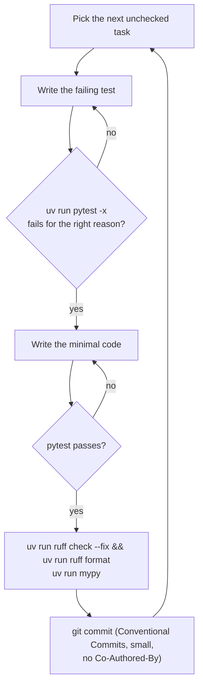

# cachemaxxing SDLC

_Derived from the cachemaxxing v0.1 plan dated 2026-10-30._

The model is an iterative, gated lifecycle (a light V-model): every requirement has a test, and every phase has an exit gate with evidence.

## 3.1 Lifecycle

```mermaid
flowchart LR
  P0["0 Inception & research<br/>(this plan)"] --> G0{"G0<br/>owner approves plan"}
  G0 --> P1["1 Design baseline<br/>design/*.md"] --> P2["2 Bootstrap<br/>repo, CI, packaging"] --> G2{"G2<br/>CI green on main"}
  G2 --> P3["3 Core (TDD)<br/>facts → prompt → economics → usage → diff → gemini"] --> P4["4 CLI<br/>diff, report"] --> G4{"G4<br/>tests + mypy + ruff<br/>green on 3.11–3.15"}
  G4 --> P5["5 Live validation<br/>quickstart × 4 + benchmarks"] --> G5{"G5<br/>spend ≤ $5,<br/>results committed"}
  G5 --> P6["6 Docs site<br/>Zensical → Pages"] --> G6{"G6<br/>site live"}
  G6 --> P7["7 TestPyPI dry run"] --> G7{"G7<br/>owner approves<br/>PyPI publish"}
  G7 --> P8["8 Tag v0.1.0 → PyPI"] --> P9["9 Maintain"]
  P9 -- "facts drift / bug / price date" --> P3
  P9 --> P10["Phase 2: npm port<br/>(separate plan)"]
```

## 3.2 Phase gates

| Phase | Entry | Exit evidence (gate) | Owner action |
|---|---|---|---|
| 0 Inception | HANDOFF.md | This plan approved (G0) | Approve the plan |
| 1 Design | G0 | `design/requirements.md`, `architecture.md` and `sdlc.md` committed | Optional review on GitHub |
| 2 Bootstrap | Phase 1 | Public repo exists; CI workflow green on main (G2); `.env` ignored | — |
| 3 Core | G2 | Every FR-1…FR-12 test passes | — |
| 4 CLI | Phase 3 | FR-13 tests pass. On every CI Python: ruff, `mypy --strict` and pytest are green (G4) | — |
| 5 Validation | G4, keys in `.env` | Quickstart prints `cache_read > 0` on the 2nd call for each provider and for LiteLLM; `benchmarks/results/*.json` and the chart are committed; total spend ≤ $5 (G5) | Confirm the spend before the first live run |
| 6 Docs | G5 | Site live with every handoff page; homepage numbers come only from the results JSON (G6) | — |
| 7 Dry run | G6 | TestPyPI release installed in a clean venv; quickstart passes (G7) | Create the TestPyPI pending publisher; approve the `testpypi` deployment; approve the PyPI publish |
| 8 Release | G7 | `pip install cachemaxxing==0.1.0` works; docs and badges resolve | Create the PyPI pending publisher; approve the `pypi` deployment |
| 9 Maintain | v0.1.0 | Monthly facts re-verification; patch on scheduled price dates | Triage issues |

## 3.3 Inner loop (every task in §6)

## 3.4 Working agreements

- **Branches:** one short-lived branch per phase (`phase-3-core`, …). Open a PR to `main` and merge only when CI is green, with a rebase merge so the small commits are kept. Phases 1–2 commit straight to `main` while bootstrapping.
- **Commit style:** `feat:`, `fix:`, `test:`, `docs:`, `ci:`, `chore:`, `bench:`. No `Co-Authored-By` lines.
- **A task is done when:**
  - a test covers the behaviour and passes
  - ruff is clean and `mypy --strict` is clean
  - public API docstrings are updated
  - a CHANGELOG `[Unreleased]` entry exists for user-visible changes
- **Versioning:** SemVer, starting at 0.1.0. CHANGELOG follows Keep a Changelog. The tag `vX.Y.Z` must equal `uv version --short` (the release job checks it).
- **Secrets:** keys live only in the git-ignored `.env`. Before every push, `git ls-files | grep -x .env` must print nothing. GitHub push protection is on by default for public repos.
- **Every outward action is confirmed with the owner first:** repo creation, Pages, each publish, each live run that spends money.

## 3.5 Maintenance

- **Monthly:** re-open every `source` URL in `facts.py`. Update the changed rows and `VERIFIED`, regenerate `docs/_facts.md`, and cut a patch release.
- **Scheduled price changes:**
  - 2026-12-01: gemini-4-argon doubles. Ship 0.1.x.
  - 2027-01-01: gemini-3.8-flash doubles, including storage. Ship 0.1.y.
- **Dependabot:** weekly, for GitHub Actions and uv.
- **Python:** add 3.16 when it is released (Oct 2027). Drop 3.11 when it reaches end-of-life (Oct 2027).

## 3.6 Risk register

| Risk | L | I | Mitigation |
|---|---|---|---|
| Provider facts drift; prices change on dates | H | H | `source` and `VERIFIED` per row, monthly check, docs table generated and guarded by a test, patch releases |
| Provider API shape changes (OpenAI 5.6+ fields are new; some details unverified) | M | M | Contract tests against pinned SDKs (B13); live quickstart (D7); fields documented with links |
| History edits break Claude preserved-thinking checks | M | H | History is never modified. Only copies get a marker, never on thinking blocks; Anthropic ignores markers. |
| Leaking `.env` keys in a public repo | M | H | `.gitignore` first, `git check-ignore` check, push protection, CI without keys |
| Supply chain (LiteLLM 2026-03, moved action tags) | M | H | Zero runtime deps, committed `uv.lock`, actions pinned by SHA, OIDC publishing with attestations |
| Benchmark overspend | L | M | `Budget` guard in every script (projected and running), owner confirms, cap of $5 |
| Name taken before publish | L | H | Pending publisher ≠ reservation. Publish right after the dry run; re-check the name first. |
| Zensical is in alpha | M | L | Exact pin in the docs group. `mkdocs.yml` keeps Material as a fallback until its EOL. |
| Implicit caching (Gemini, OpenAI legacy) is best-effort, so benchmarks are noisy | H | L | 3 repetitions per arm; report mean, min and max; say "not guaranteed" in the docs |
