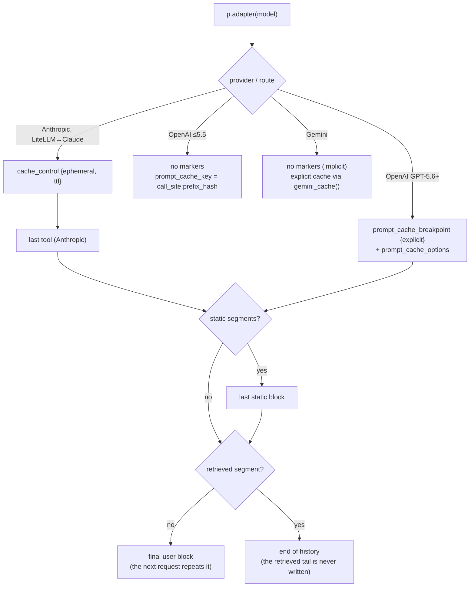

# How prompt caching works

Every major provider caches by **prefix**. When the start of a request is byte-identical to a recent request (same model, within the time-to-live, above a minimum size), that part is billed at a fraction of the input price. One changed byte invalidates everything after it.

What differs is who places the cache entries, what writes cost, and how long entries live.

## Anthropic

- You mark cache breakpoints with `cache_control: {"type": "ephemeral"}` (5-minute TTL) or `{"type": "ephemeral", "ttl": "1h"}`. At most **4** per request.
- The rendered order is tools → system → messages. A breakpoint caches everything before it.
- Writes cost **1.25×** (5 min) or **2×** (1 h) the input price; reads cost **0.1×** (0.05× on Opus and Sonnet 5.5, 0.025× on Fable 5.1). Every hit refreshes the TTL for free.
- Prefixes shorter than the model's minimum (512 tokens on current models, up to 4,096 on older ones) silently don't cache.
- `usage.input_tokens` **excludes** cached tokens; the full prompt is `input_tokens + cache_creation_input_tokens + cache_read_input_tokens`.
- Claude 5.5-era models check that history is append-only, so cachemaxxing never edits earlier messages; markers are not content.

## OpenAI

- **GPT-5.6 and later** support explicit breakpoints: `prompt_cache_breakpoint: {"mode": "explicit"}` on a text part of an input message, with `prompt_cache_options: {"mode": "explicit", "ttl": "30m" | "12h"}` on the request (12 h is Responses-only). Writes cost **1.25×** (30 min) or **2.5×** (12 h); reads **0.1×** (0.05× on GPT-6.1 Sol and Terra). Minimum 1,024 tokens.
- OpenAI only looks up cache entries at breakpoints present in the request. So cachemaxxing marks the end of the static prefix, the position the previous request wrote, and the new end. That lets a conversation keep reading its whole history even when you rebuild history from plain strings.
- In the default implicit mode, OpenAI writes a cache entry at the end of the latest message on every request. A prompt whose tail changes every time pays write premiums on bytes that are never read again.
- **GPT-5.5 and older** cache implicitly with no write charge; `prompt_cache_key` helps route requests that share a prefix to the same machine (about 15 requests per minute per key).
- `input_tokens` / `prompt_tokens` **include** cached and written tokens.

## Gemini

- **Implicit caching** is on by default for Gemini 2.5 and later, with no write cost; the discount is applied when a hit happens, which is **not guaranteed** and needs a few seconds to warm up. Minimum 4,096 tokens on Gemini 3.x and 4.
- **Explicit caching** (`client.caches.create`) guarantees the hit for a TTL you choose, at the input price to create plus hourly storage. A request that uses a cache must not resend the cached `system_instruction` or `tools`. Not available on Gemini 4 Argon.
- `prompt_token_count` **includes** `cached_content_token_count`; `thoughts_token_count` is billed as output.

## LiteLLM

LiteLLM takes OpenAI-format messages and translates them. cachemaxxing's `p.litellm(model)` picks the right fields per route: `cache_control` on content parts (and inside the tool's `function`) for Claude, explicit breakpoints for `openai/` GPT-5.6+, and nothing for `gemini/` unless you pass `explicit=True` (LiteLLM then creates an explicit cache for the static prefix).

## Where cachemaxxing puts the markers

## Facts table

Every number below lives in `cachemaxxing.facts` and links to its source. `est_cost` values use these prices.

--8<-- "docs/_facts.md"
