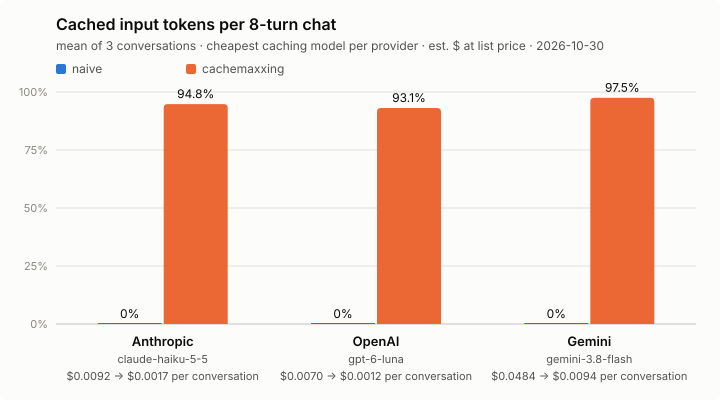

# cachemaxxing

**Stop paying full price for the same tokens.**

Anthropic, OpenAI and Gemini bill a repeated prompt prefix at a fraction of the input price, but only when the bytes really repeat. cachemaxxing finds where they don't, tells you what it costs, and lays your prompts out so they do.

1. **Measure.** `usage()` turns every provider's response into the same numbers: input, cache read, cache write, output, estimated $ and hit rate. `cachemaxxing report` totals them per call site.
2. **Diagnose.** `cachemaxxing diff` shows the first byte where two consecutive requests diverge, and why: a timestamp, a UUID, tool order, JSON key order.
3. **Fix.** `Prompt` orders your prompt from most to least stable and places each provider's cache markers for you.

```python
from openai import OpenAI
from cachemaxxing import Prompt, usage

chat = [
    {"role": "system", "content": SYSTEM},  # your long, fixed instructions: cached
    {"role": "user", "content": "How do I reset my router?"},
]
p = Prompt(call_site="support.answer").messages(chat)  # call_site: any name for this call, used in reports

resp = OpenAI().chat.completions.create(**p.openai_chat("gpt-6-luna"))
# same p: anthropic.messages.create(max_tokens=1024, **p.anthropic("claude-haiku-5-5"))
#         genai_client.models.generate_content(**p.gemini("gemini-3.8-flash"))

u = usage(resp)
print(f"{u.hit_rate:.0%} of input from cache, ~${u.est_cost or 0:.4f}")
```

The system prompt and the conversation so far get the provider's cache markers, so each turn reads everything before the new question from cache. For tools, RAG chunks or a timestamp, build the prompt from parts: `p.tools(TOOLS).system(SYSTEM).history(chat).retrieved(chunks).user(question)`. The quickstart shows [where the markers go, and the exact request](quickstart.md).

It is a thin library, not a proxy: you keep your own SDK client.

## Benchmark



- **Against a sloppy app** (the naive arm, chat and RAG): input cost is 76–88% lower on every model.
- **Against a clean prompt using the provider's own one-line caching**, it depends on the provider:
  - *Anthropic:* automatic caching puts its single cache entry after the per-turn context (time, request id, retrieved chunks). That entry changes every turn, so the app pays the 1.25× write premium on every call and reads nothing back. That is 0% cached, and dearer than not caching at all. A breakpoint after the static prompt, which cachemaxxing places, fixes it: 82–89% cheaper.
  - *Gemini:* implicit caching is best-effort and reached 39–56%. The explicit cache cachemaxxing creates when `should_cache()` says it pays reached 88–97%, 62–67% cheaper, with creation and storage included.
  - *OpenAI:* implicit caching already finds a stable prefix, and cachemaxxing is only 6–19% cheaper. On OpenAI the win is fixing the habits, plus the measuring tools.
  - *LangChain agents:* `CacheMiddleware` ties LangChain's `AnthropicPromptCachingMiddleware` on Anthropic and the default agent on OpenAI. It adds one setup for every provider and per-call-site measurement, not extra savings.

| Workload | Model | naive | clean + provider auto-caching | cachemaxxing | vs naive | vs clean |
|---|---|---|---|---|---|---|
| chat | `claude-haiku-5-5` | 0% · $0.0090 | 0% · $0.0112 | 94.4% · $0.0014 | 84% cheaper | 87% cheaper |
| chat | `gpt-6-luna` | 0% · $0.0068 | 92.8% · $0.0009 | 94% · $0.0009 | 87% cheaper | 6% cheaper |
| chat | `gemini-3.8-flash` | 0% · $0.0468 | 55.6% · $0.0236 | 97.3% · $0.0077 | 83% cheaper | 67% cheaper |
| chat | `claude-sonnet-5-5` | 0% · $0.1791 | 0% · $0.2232 | 92.4% · $0.0247 | 86% cheaper | 89% cheaper |
| chat | `gpt-6.1-sol` | 0% · $0.1389 | 88.4% · $0.0209 | 91% · $0.0168 | 88% cheaper | 19% cheaper |
| rag | `claude-haiku-5-5` | 0% · $0.0069 | 0% · $0.0086 | 87.4% · $0.0015 | 78% cheaper | 82% cheaper |
| rag | `gpt-6-luna` | 0% · $0.0049 | 84.1% · $0.0011 | 85.6% · $0.0010 | 80% cheaper | 15% cheaper |
| rag | `gemini-3.8-flash` | 0% · $0.0352 | 39.1% · $0.0226 | 88.2% · $0.0086 | 76% cheaper | 62% cheaper |
| agent | `claude-haiku-5-5` | 0% · $0.0044 | 89.8% · $0.0010 | 89.9% · $0.0009 | 78% cheaper | 1% cheaper |
| agent | `gpt-6-luna` | 90.4% · $0.0006 | — | 90.1% · $0.0006 | 2% dearer | — |

Cells: cached share of input tokens · estimated input cost per conversation at list price (cache writes and explicit-cache storage included; output excluded, since answer length varies between runs regardless of caching).

Setup: 8-turn conversations (agents: 3 questions with a tool call), 3 customers per arm. Every arm starts from a cold cache with its own prompt, so no arm reads another's entries. The naive arm has the four habits: a timestamp and request id at the top of the system prompt, tool order that varies, JSON key order that varies, and history re-rendered every turn; in RAG, chunks also go in the system prompt. The clean arm has the same content laid out well, with Anthropic's top-level `cache_control` or OpenAI's and Gemini's default implicit caching. Data: [`benchmarks/results/`](https://github.com/ashhadahsan/cachemaxxing/tree/main/benchmarks/results), run 2026-10-30. Rerun with `uv run --env-file .env python benchmarks/bench_<provider>.py --workload chat|rag` and `benchmarks/bench_agent.py`; the table comes from `benchmarks/summary.py`.

## Install

```console
pip install cachemaxxing
uv add cachemaxxing
```

There are no runtime dependencies. Extras pull in a provider SDK: `cachemaxxing[anthropic]`, `[openai]`, `[gemini]`, `[litellm]`.

Next: the [quickstart](quickstart.md).
